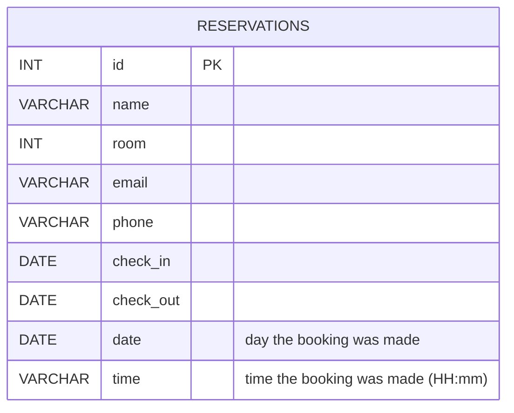

# Hotel Reservation System — Java & JDBC

A console-based hotel reservation system built with **Java, JDBC, and MySQL**. The project demonstrates how to build a database-driven Java application with CRUD operations, object-oriented design, JDBC database connectivity, exception handling, and separation of application responsibilities.

This project was built as a hands-on Java application to practice connecting a Java program to a relational database and organizing database operations into separate layers.

## Features

* Create hotel reservations with check-in / check-out dates
* **Double-booking prevention**: a room cannot be booked for overlapping dates (same-day turnover is allowed)
* View existing reservations in a formatted table
* **Search** reservations by name or phone
* **Check room availability** for a date range
* Update any reservation field (name, phone, email, room, dates), addressed by reservation id
* Delete reservations (with confirmation)
* Input validation with re-prompting (name, phone, email, room, dates), and `cancel` at any prompt
* Store reservation data in MySQL
* Connect Java to MySQL using JDBC
* Use `PreparedStatement` for parameterized SQL queries
* Generate booking date and time automatically
* Separate database operations from application logic
* Use a Java model class to represent reservation data
* Console-based menu-driven interface

## Technologies Used

| Technology    | Purpose                             |
| ------------- | ----------------------------------- |
| Java          | Application development             |
| JDBC          | Java-to-MySQL database connectivity |
| MySQL         | Relational database                 |
| SQL           | Database operations                 |
| IntelliJ IDEA | Development environment             |

## Project Architecture

The application separates responsibilities into different packages:

```text
src/
├── app/
│   ├── Main.java                    (entry point)
│   └── ConsoleMenu.java             (all console input/output)
│
├── model/
│   └── Reservation.java
│
├── services/
│   └── HotelReservationService.java (validation + business rules)
│
├── dao/
│   ├── ReservationRepository.java   (storage contract)
│   └── HotelReservationDB.java      (JDBC implementation)
│
├── connection/
│   └── DBConnection.java
│
├── exception/
│   ├── ReservationException.java    (business / validation errors)
│   └── DataAccessException.java     (database errors)
│
└── util/
    ├── DateAndTime.java
    └── Validator.java

sql/
├── schema.sql                       (fresh install)
└── migration.sql                    (upgrade from the original schema)

test/
└── TestRunner.java                  (unit + console tests, no database needed)
```

### Application Flow

```text
User
 │
 ▼
Main ──► ConsoleMenu
 │
 ▼
HotelReservationService
 │
 ├──────────────► Reservation Model
 │
 ▼
HotelReservationDB
 │
 ▼
DBConnection
 │
 ▼
JDBC
 │
 ▼
MySQL
```

### Package Responsibilities

**`app`**

Contains the application entry point (`Main`) and the console user interface (`ConsoleMenu`).

**`model`**

Contains Java classes that represent application data. The `Reservation` class stores reservation information such as the client name, phone number, email, room number, date, and time.

**`services`**

Contains the business logic. `HotelReservationService` validates input and coordinates reservation operations. It does no console I/O.

**`dao`**

Contains database operations. `HotelReservationDB` executes SQL against the reservations table. Writes run inside a transaction together with the overlap check.

**`connection`**

Contains the JDBC connection logic used to connect the application to MySQL.

**`util`**

Contains reusable utility functionality such as generating the current date and time.

## Database Design



### Database Setup

Run `sql/schema.sql` for a fresh install:

```bash
mysql -u root -p < sql/schema.sql
```

Upgrading a database created with the original version of this project? Run `sql/migration.sql` instead (back up first).

## Configuring the Database Connection

Credentials are not stored in the source code. Set them with environment variables:

| Variable            | Default                                  |
| ------------------- | ---------------------------------------- |
| `HOTEL_DB_URL`      | `jdbc:mysql://localhost:3306/hotel_db`   |
| `HOTEL_DB_USER`     | `root`                                   |
| `HOTEL_DB_PASSWORD` | *(empty)*                                |

or with JVM properties `-Dhotel.db.url=... -Dhotel.db.user=... -Dhotel.db.password=...`.

## Running the Project

### Prerequisites

* JDK 11 or newer
* MySQL Server 8+
* [MySQL Connector/J](https://dev.mysql.com/downloads/connector/j/) jar. Copy it into `lib/`
* Apache Ant (only if you build from the command line)

### Steps

```bash
git clone https://github.com/Hamadullah-Odho/HotelReservationSystem-JDBC.git
cd HotelReservationSystem-JDBC

mysql -u root -p < sql/schema.sql          # 1. create the database
export HOTEL_DB_PASSWORD='your-password'   # 2. configure (Windows: set HOTEL_DB_PASSWORD=...)
ant test jar                               # 3. run the tests and build dist/HotelReservationSystem.jar
java -jar dist/HotelReservationSystem.jar  # 4. run
```

In IntelliJ IDEA: add the Connector/J jar as a library, mark `src` as *Sources* and `test` as *Test Sources*, and run `app.Main`.

> `ant run` cannot be used for the interactive menu because Ant does not forward keyboard input to the program.

## How It Works

### Preventing double bookings

A stay occupies the half-open range `[check_in, check_out)`. A new or edited reservation is rejected if another reservation for the same room satisfies:

```sql
existing.check_in < new.check_out AND existing.check_out > new.check_in
```

The check and the `INSERT`/`UPDATE` run in one transaction (`SELECT ... FOR UPDATE`), so two users cannot both grab the same room.

### PreparedStatement

All SQL uses `PreparedStatement` parameters, never string concatenation of user input. Search text is additionally escaped so `%` and `_` are matched literally.

### Error handling

* Invalid input is reported with a specific message and the question is asked again (type `cancel` to go back).
* Business-rule problems (room taken, reservation not found) raise `ReservationException`.
* SQL problems are wrapped in `DataAccessException`. Connections are always closed (try-with-resources) and failed transactions are rolled back.
* If the database is unreachable at startup, the app prints the reason and exits instead of crashing later.

## Tests

```bash
ant test
```

`test/TestRunner.java` covers the validators, the overlap rule, the service logic and a complete scripted console session. It uses an in-memory repository, so no MySQL is needed.
